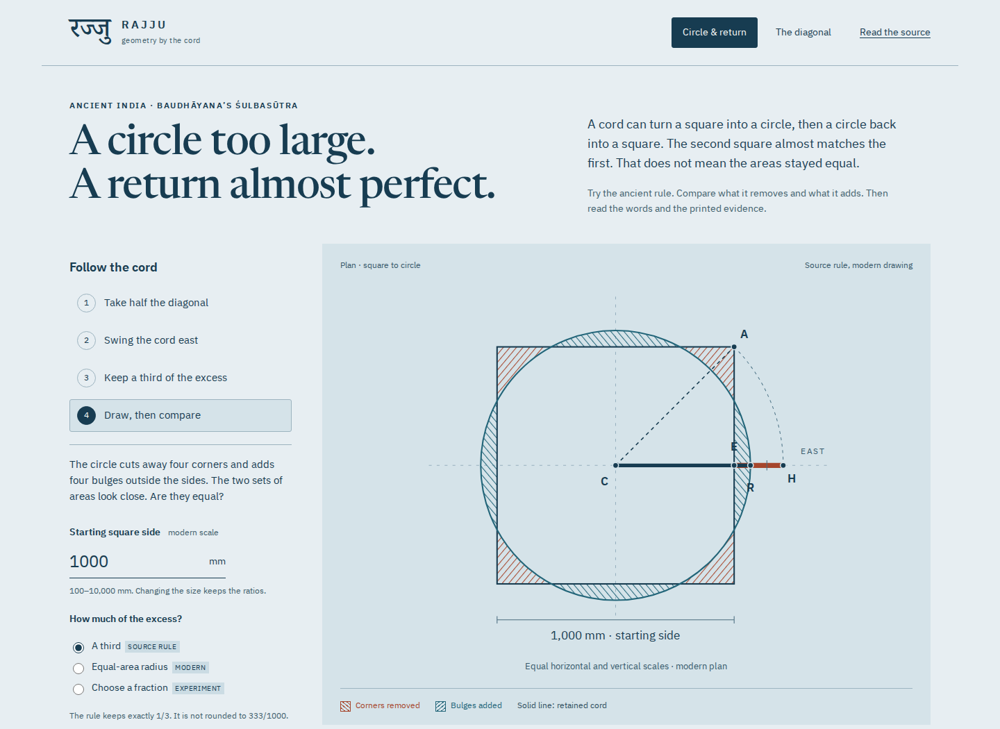
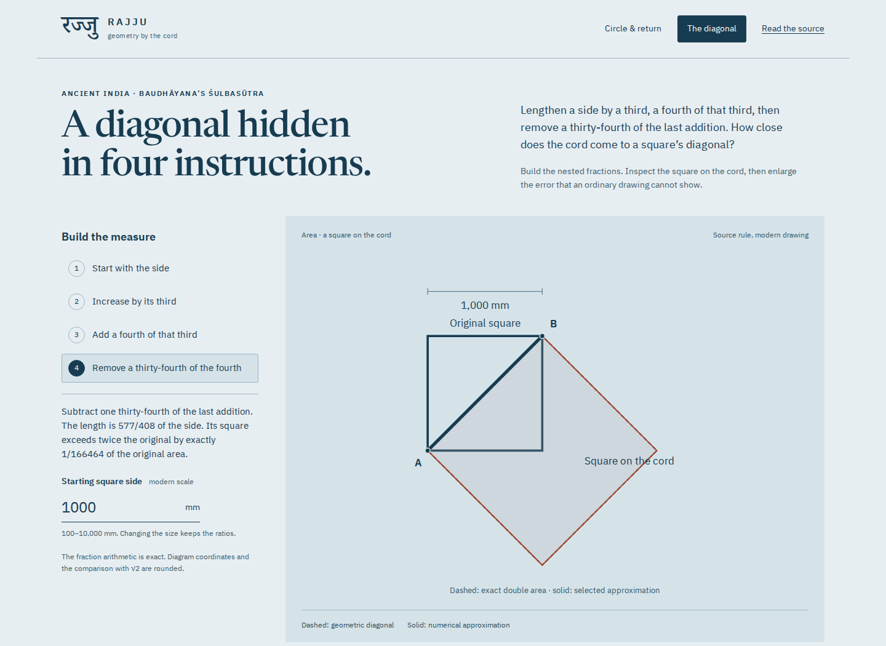

# Rajju

**A circle too large. A return almost perfect.** Explore Indian cord geometry
through a working construction, Sanskrit instructions and the printed evidence.

[MIT license](LICENSE) · [Source decisions](THIRD_PARTY.md) · [Mathematical model](docs/model.md)

A circle made by one Śulbasūtra rule is about 1.725% larger than the original
square. Apply the detailed return rule and the new square almost matches the
first. Checking only the endpoints hides what happened in between. Rajju lets
you draw the cord, inspect the actual lost and gained regions, alter the rule,
and compare all three areas against their proper references.



Publication status: this repository and its reviewed build are local. No remote
repository, hosted deployment or registry release is claimed. The intended
Pages address is `https://antonsoo.github.io/rajju/`.

## Try it locally

From the `showcases` workspace, with Node.js 24 or newer:

```sh
cd rajju
npm ci
npm run dev
```

Open `http://127.0.0.1:4392/rajju/`. For a production build, use `npm run build`;
the complete site is written to `dist/`. `npm run preview` serves that build on
the same port. Run development and preview one at a time. Development does not
install a service worker.

## Follow the cord, then check the area

1. Choose **Take half the diagonal**. A cord joins the centre and a corner.
2. **Swing the cord east**. The projecting piece is shorter than the whole cord.
3. **Keep a third of the excess**, then **Draw, then compare**. The rule divides
   only the projecting piece. The source third stays exactly 1/3.
4. Compare the four cut-away corners and four added bulges. Then inspect the
   returned square. Its close match with the first square is a different claim
   from matching the intermediate circle.

The second return option keeps 13/15 of the diameter. A modern equal-area
comparison and a custom fraction let you alter the construction explicitly.
Use a side from 100 to 10,000 mm; this is a modern physical scale, not a
conversion of an ancient unit. Both drawing axes retain the same scale.

| At a chosen starting side of 1000 mm | Result         | Reference                              |
| ------------------------------------ | -------------- | -------------------------------------- |
| Source circle radius                 | 569.035594 mm  | Half-side plus one third of the excess |
| Source circle area error             | +1.725243539%  | Starting square                        |
| Detailed returned side               | 1000.002386 mm | Circle diameter × 9785/11136           |
| Detailed returned square area error  | +0.000477179%  | Starting square                        |
| Returned square area error           | -1.695515461%  | Intermediate circle                    |

The values come from the current calculation and independent checker. The
enlarged error ruler is a rescaled number line; the construction itself stays
proportional. The model does not infer physical cord accuracy from pixels.

## Read the diagonal in four instructions

Choose **The diagonal**. Build the nested fractions rather than rounding a
decimal to a few digits:

```text
side    add its third    add a fourth of that third    remove 1/34 of the fourth
 1  -->     4/3      -->           17/12           -->          577/408
```

The final square on that cord has area `332929/166464` times the original.
The target is twice the original, `332928/166464`. A single small square
remains: `1/166464` of the original area, or `1/332928` of the target.

At a 1000 mm side, the numerical cord is about 0.002123901 mm longer than the
geometric diagonal. The difference is too small for the ordinary plan to show.
The magnified ruler and exact fractions retain it. A second diagram illustrates
Thibaut's overlapping-strip explanation and identifies it as his conjectural
account, not a proof stated by the ancient rule.



## Read and keep the sources

- Four normalized Sanskrit excerpts, IAST transliterations and new English
  translations cover circling, both return rules and the numerical diagonal.
- Eleven selectable word notes explain geometrical references and grammar;
  no Sanskrit prerequisite or reconstructed pronunciation is assumed.
- Nine complete printed pages from George Thibaut's 1875 _The Śulvasūtras_.
  Enlarge and pan, open the original image, and follow the complete volume link.
  The p. 28 note retains the printed 412/408 discrepancy instead of hiding it.
- Share a URL that retains the controls, passage and independently selected
  source page. Browser history restores the selection.
- Download measurements as CSV, with a named reference for every area error.
- Save an illustrated HTML reading with all nine source pages, source-language
  text, fonts, license notices and a CSV download embedded. It opens and prints
  without a network or scripts. Sources and fonts are verified before export.
- Use the app offline after its footer confirms the current edition is complete.
  No accounts, remote fonts, analytics or runtime services.

Inspect an actual [saved circle reading](examples/circle-reading.html.gz), its
[15-page PDF](examples/circle-reading.pdf), and the [measurement CSV](examples/circle-measurements.csv).
The [diagonal CSV](examples/diagonal-measurements.csv) retains the exact fractions.
These are captured from the local build; no hosted edition is implied.

## How it works and how it was checked

Pure geometry, rational arithmetic and URL validation live in `src/core/`.
The DOM, SVG drawings, CSV and saved reading consume those results. The circle
uses a true geometric diagonal; the separate numerical-diagonal lesson uses
577/408. This distinction prevents the much smaller length error from being
confused with the circle's larger area error.

The [model](docs/model.md) derives the areas and reference choices. The independent
Python checker imports no application code. It transcribes the printed fractions
and integrates the actual bulges in polar coordinates, instead of reusing the
app's closed-form circular segment calculation.

```sh
npm run check
npm run verify:geometry
npm run test:browser -- /tmp/rajju-browser
```

The browser command serves the existing `dist/` on isolated local origins;
do not rebuild while it runs. It requires installed Playwright Chromium and
Firefox. On a new machine, install them once with
`npx playwright install --with-deps chromium firefox`. Then independently check
the actual SVG coordinates and real CSV downloads:

```sh
python3 scripts/geometry-oracle.py --rendered < /tmp/rajju-browser/browser.json
npm run test:offline
python3 scripts/source-review.py
```

The source reviewer requires Poppler's `pdftoppm`; it downloads the identified
PDF if `--pdf <path>` is omitted. Renderer identities are recorded. The offline
review holds a page for nine seconds, substitutes a different valid JPEG,
checks pending/refusal behavior, then restores the source and verifies recovery.

The [review](docs/review.md) retains browser, geometry, source, print and clean
install evidence. Chromium and Firefox were exercised at 1440 and 375 px through
keyboard controls, source zoom and pan, browser history, invalid links, downloads,
independent saved files and offline reloads after the origin closed. Automated
accessibility findings apply to those states, not to every possible user or device.

## Accuracy and limits

This is a guided reading of selected rules, not a complete altar reconstruction
or a new critical edition. Sanskrit spacing and punctuation are normalized from
the 1875 print; English and IAST are reading aids. The sūtra, later commentary,
Thibaut's historical conjectures and modern numerical analysis have different
evidential status. No date of invention, comparative priority, proof of
irrationality or transmission route is established here.

Millimetres are illustrative. The app omits construction tolerances, soil,
brick courses, cord stretch and ritual practice. The exact rational factors do
not make the ancient circle-area transformations exact. JavaScript roots,
decimal displays and SVG coordinates are rounded. Linked external editions
remain online resources; the bundled pages belong to the offline edition.

## Contributing and license

Corrections tied to an exact printed passage, or a reproducible geometric
counterexample, are especially useful. See [CONTRIBUTING.md](CONTRIBUTING.md).

Code, new diagrams and English notes: [MIT](LICENSE), Anton Soloviev, 2026.
Historical pages are public domain; fonts retain their [separate notices](THIRD_PARTY.md).
