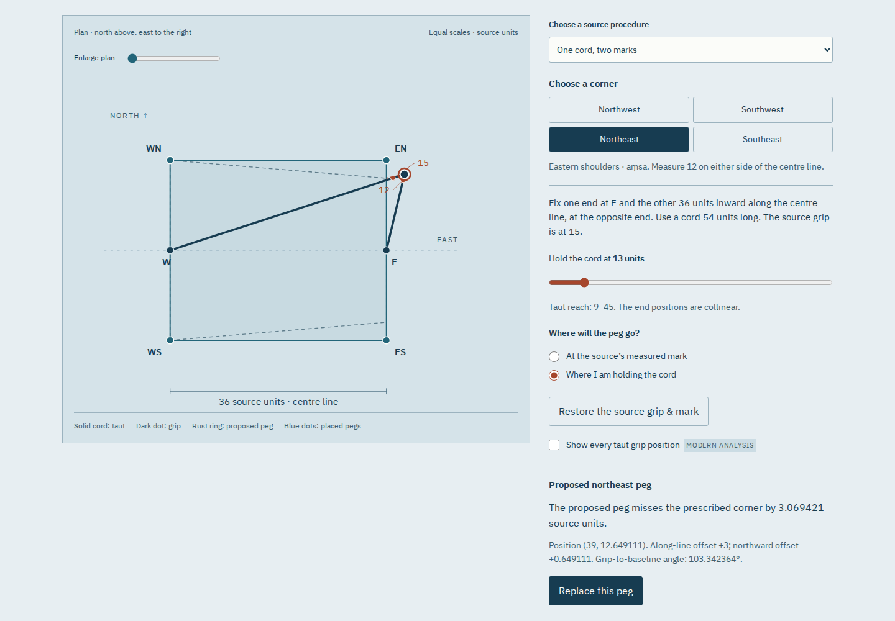

# Marked-cord ground review

The room now publishes [Āpastamba's ground layout](https://antonsoo.github.io/rajju/field.html).
The [model and source table](field-model.md) explain why a 15-unit grip can
establish a perpendicular while a different 12-unit mark locates the corner.
All four source procedures yield 972 square source units. Replacing the two
eastern stakes with their grips yields 1080, while retaining the perpendiculars.
These are ideal plan constructions, not measurements of a historical site.

## Evidence

| Reviewed workflow                                                        | Recorded result                                                                                                                                                 |
| ------------------------------------------------------------------------ | --------------------------------------------------------------------------------------------------------------------------------------------------------------- |
| Fresh anonymous public clone, Node 24.22.0, `npm ci` and `npm run check` | Pass; built bytes equal the reviewed working checkout                                                                                                           |
| Four source methods, both ends and sides                                 | All 16 placements meet the prescribed coordinates; area 972                                                                                                     |
| Independent two-distance solution                                        | 544 model cases, 60-digit Decimal bisection; maximum coordinate difference below 9e-14 source units                                                             |
| Built-site browser workflow                                              | 80 actual rendered constructions across Chromium and Firefox, 1440 and 375 px                                                                                   |
| Retained choices                                                         | Proposed grip 13 remains distinct from placed eastern grips 15, including after URL reload and in CSV                                                           |
| Native illustrated reading                                               | Four original JPEGs and three original fonts embedded exactly; no scripts or runtime network requests                                                           |
| Native print                                                             | Eight-page A4 PDF captured from the saved field reading and visually inspected                                                                                  |
| Source reproduction                                                      | All twelve page renderings match the identified PDF and renderer; all 21 bundled public assets match their identities                                           |
| Source and plan magnification                                            | Real image decoding, zoom and keyboard pan in both engines                                                                                                      |
| Accessibility scan                                                       | Zero selected WCAG 2/2.1 A/AA violations in the exercised states; mobile table is keyboard scrollable                                                           |
| Offline use                                                              | Origin closed: reload field, navigate to circle and back, decode a newly selected scan and save another complete reading                                        |
| Upgrade from first public edition                                        | Four browser/scenario combinations: hold or substitute a newly added JPEG, refuse readiness, recover, replace the 21-file cache with the complete 28-file cache |
| Development server                                                       | Twelve journeys across all rooms; real downloads and drawing styles; no service-worker registration                                                             |

Machine-readable receipts are in [field-review/](field-review/), including the final [public-clone check](field-review/public-clean.json). The original
circle/diagonal journeys were rerun after extracting the shared asset/export
helpers: 44 actual constructions and independent rendered/CSV comparisons pass.
The field review scripts serve the existing build; the independent Python
checker imports no application code and carries its own transcribed source table.

The upgrade review starts with the first public build, then serves the current
build on the same origin. An old open page reports a different saved edition
after activation until it reloads. The new field page does not claim readiness
while the new scan is delayed or wrong. Cached old source pages survive a failed
install, and the recovered worker serves both rooms with the server closed.

The paper template is a native SVG with physical dimensions. One chosen paper
unit is 3 mm, its 36-unit centre line is 108 mm, and its calibration bar is 30 mm.
This verifies file geometry; a physical printer was not exercised. It always
restores the selected source procedure and says so on the file and in the UI.

## Publication boundary

Application source was published at
[`12e1ddf`](https://github.com/antonsoo/rajju/commit/12e1ddf3b0b53ca65f48c0f39a0cb2439fbcf02e).
The paper-only label spacing was then improved in `3b2c66b`; the current public application includes that fix. All 29 canonical hosted files match the reviewed production build. The hosted
field workflow also passes all four browser/viewport journeys, including native
downloads, independent saved files and network-offline navigation. Its 80 SVG
constructions pass the independent coordinate and cord-length checker.

See [hosted bytes](field-review/hosted-bytes.json),
[hosted browser workflow](field-review/hosted-browser.json), and
[hosted geometry](field-review/hosted-rendered.json).
These establish the recorded public bytes and exercised browser behavior.
They do not assert hosted CI success, a registry release, physical cord accuracy,
ancient dating, linguistic authority or an archaeological reconstruction.
